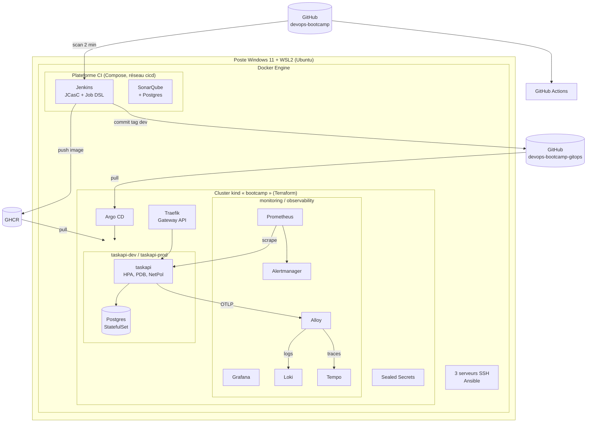

# Module 11 — Projet final : toute la chaîne, de zéro, sous incident

> **Objectif** : prouver (à toi-même) que tu maîtrises la chaîne complète : la **reconstruire de zéro**, **livrer** une fonctionnalité jusqu'en prod, **survivre à des incidents**, et savoir **l'expliquer** clairement en 5 minutes comme en entretien.
>
> **Durée** : ~6 h · Pas de nouveau concept : c'est l'heure de vérité.

---

## 1. L'architecture que tu as construite

---

## 2. Savoir le raconter : le pitch de 5 minutes

En entretien, on te demandera presque toujours : « Décris une chaîne CI/CD que tu as mise en place. » Structure ta réponse ainsi (entraîne-toi à voix haute, chronomètre) :

1. **Le contexte** (20 s) : une API Python conteneurisée, deux environnements, objectif : livrer souvent et sans risque.
2. **Du commit à l'image** (1 min) : PR → pipeline Jenkins en conteneurs (lint, tests, couverture) → quality gate SonarQube → build multi-stage non-root → scans gitleaks/hadolint/Trivy (gate sur CRITICAL corrigeables) → SBOM → image taguée par SHA sur GHCR. Même pipeline en GitHub Actions, actions épinglées par SHA (et pourquoi : Trivy mars 2026).
3. **De l'image à la prod** (1 min) : GitOps. La CI ne touche pas le cluster ; elle commite le tag dans le repo de config. Argo CD (pull) synchronise dev ; la prod se promeut par PR (même image, pas de rebuild) ; rollback = git revert. Secrets scellés.
4. **La plateforme** (1 min) : cluster et socle en Terraform (stacks séparées, imports, versions épinglées), Gateway API (ingress-nginx retiré), Pod Security restricted, NetworkPolicies, HPA/PDB. Ansible pour les serveurs hors Kubernetes.
5. **L'exploitation** (1 min) : RED + SLO 99 % avec alertes de burn rate, logs centralisés (Loki/Alloy), traces OTel (Tempo) corrélées aux logs ; runbooks ; postmortems blameless.
6. **Les chiffres et les limites** (40 s) : lead time commit → dev en X min, reconstruction complète en Y min ; ce que tu ferais en vrai (cloud managé, Vault + External Secrets, Argo Rollouts, multi-cluster, Kaniko au lieu du socket Docker, SSO…).

Avoir des **limites lucides** est un signal fort de séniorité.

---

## 3. Critères d'un système « production-grade » (à vérifier aujourd'hui)

| Domaine | Question |
|---|---|
| Reproductibilité | Puis-je tout recréer depuis Git sans clic ? |
| Traçabilité | Pour ce qui tourne en prod : quel commit ? quelle image (digest) ? qui l'a approuvé ? |
| Sécurité | Aucun secret en clair dans Git/images/logs ? Moindre privilège ? Images scannées ? |
| Résilience | Un pod/nœud tombe : impact ? Un mauvais déploiement : impact ? |
| Observabilité | Serais-je alerté·e avant l'utilisateur ? Puis-je trouver la cause en < 15 min ? |
| Réversibilité | Combien de temps pour revenir à la version précédente ? |
