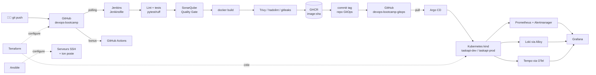

# 🚀 Mini-bootcamp DevOps — du conteneur à la prod observée

> 13 jours (14 → 26 octobre 2026), ~5-6 h/jour, **100 % local et gratuit**, sur ton PC Windows 11 + WSL2.
> Objectif : remettre à plat **toute la chaîne DevOps** que tu as déjà utilisée en prod, mais en comprenant *pourquoi* chaque brique existe et *comment* elle fonctionne dedans.

---

## La chaîne complète que tu vas reconstruire



## Planning

| Date | Module | Thème | Durée |
|---|---|---|---|
| Mar 14/10 | [00-setup](00-setup/) | WSL2, Docker Engine, outillage, Linux & Git en profondeur | 5-6 h |
| Mer 15/10 | [01-docker](01-docker/) | Conteneurs : namespaces, cgroups, images, Dockerfile pro, Compose, sécurité | 5-6 h |
| Jeu 16/10 | [02-kubernetes-bases](02-kubernetes-bases/) | Architecture K8s, Pods, Deployments, Services, probes, ressources, debug | 5-6 h |
| Ven 17/10 | [03-kubernetes-avance](03-kubernetes-avance/) | Gateway API, StatefulSet, HPA, RBAC, NetworkPolicy, Helm, Kustomize | 6 h |
| Sam 18/10 | [04-terraform](04-terraform/) | IaC, state, modules, import, cluster kind + plateforme + GitHub en code | 5-6 h |
| Dim 19/10 | [05-ansible](05-ansible/) | Inventaires, playbooks, rôles, Vault, idempotence sur 3 « serveurs » | 5-6 h |
| Lun 20/10 | [06-ci-jenkins](06-ci-jenkins/) | CI/CD, Jenkins as Code (JCasC), Jenkinsfile, agents Docker | 5-6 h |
| Mar 21/10 | [07-qualite-devsecops](07-qualite-devsecops/) | SonarQube, Trivy, gitleaks, GHCR, SBOM, GitHub Actions | 5-6 h |
| Mer 22/10 | [08-gitops-argocd](08-gitops-argocd/) | GitOps, Argo CD, app-of-apps, ApplicationSet, Sealed Secrets, promotion | 6 h |
| Jeu 23/10 | [09-observabilite-metriques](09-observabilite-metriques/) | Prometheus, PromQL, ServiceMonitor, alerting, Grafana as code | 5-6 h |
| Ven 24/10 | [10-logs-traces-slo](10-logs-traces-slo/) | Loki + Alloy, OpenTelemetry + Tempo, SLI/SLO, burn rate, postmortem | 5-6 h |
| Sam 25/10 | [11-projet-final](11-projet-final/) | Tout reconstruire de zéro + 4 incidents simulés | 6 h |
| Dim 26/10 | [12-bilan](12-bilan/) | Auto-évaluation, questions d'entretien, reconstitution à blanc | 4-5 h |

### Module indépendant : les commandes de base

| Module | Thème | Durée |
|---|---|---|
| [17-commandes-de-base](17-commandes-de-base/) | Les réflexes de la ligne de commande, **chaque commande en Linux (bash) ET en PowerShell** : fichiers, `head`/`tail`, droits (`chmod` / `icacls`), processus (`kill`, `kill -9` / `Stop-Process -Force`), services, disque, réseau, `grep` / `Select-String`, redirections. 50 exercices dans un bac à sable | 3-4 h |

À faire quand tu veux, idéalement **avant le module 01** si les commandes ne sont plus fluides.

### Parcours complémentaire « DevOps en milieu bancaire » (≈ 4 jours)

Les outils que demandent les missions infra/DevOps en banque, à faire après le tronc commun (modules 05 et 06 requis).

| Module | Thème | Durée |
|---|---|---|
| [13-contexte-bancaire](13-contexte-bancaire/) | Production bancaire : environnements, ITIL (RFC, CAB, changements), batch de nuit, DORA (le règlement), PCA/PRA, vocabulaire, livrables (DEX, consignes) | 3-4 h |
| [14-ordonnancement](14-ordonnancement/) | Ordonnancement : concepts universels, **Control-M** en profondeur (architecture, objets, Jobs-as-Code JSON, `ctm`), pratique sur une chaîne d'arrêté comptable avec **Airflow** (gratuit) | 6 h |
| [15-zabbix](15-zabbix/) | **Zabbix 7.0 LTS** : agents déployés par Ansible, auto-enregistrement, templates, HTTP/Prometheus, web scenarios, triggers, webhooks, maintenances, API | 5-6 h |
| [16-xl-release](16-xl-release/) | **XL Release** (Digital.ai Release) : orchestration des MEP, gates, séparation des tâches, gel, intégration Jenkins, Release as code, API | 5-6 h |

> ⚖️ Control-M et XL Release sont des logiciels **commerciaux** : Control-M se pratique avec Airflow (concepts identiques) + écriture de JSON Control-M, et en vrai si tu obtiens un **Control-M Workbench** ; XL Release se pratique avec sa **licence d'essai Docker de 7 jours**. Zabbix et Airflow sont entièrement gratuits.

Coche ta progression dans [PROGRESSION.md](PROGRESSION.md).

## Comment est organisé chaque module

```
NN-module/
├── COURS.md      🧠 théorie détaillée : concepts, fonctionnement interne, pièges, bonnes pratiques
├── LABS.md       🛠️ exercices guidés pas à pas + un challenge final sans guide
├── solutions/    ✅ corrigés — l'arborescence reflète la racine du repo
├── check.sh      🔎 vérifie automatiquement ton travail (make check-NN)
└── QUIZ.md       ❓ questions de révision / entretien (réponses repliées)
```

**Méthode conseillée pour chaque journée :**

1. **Lire `COURS.md`** (~1 h 30) — prends des notes, même si tu « connais déjà ». Le but est de combler les zones floues.
2. **Faire `LABS.md`** (~3 h) — tape les commandes, ne copie-colle pas aveuglément. Quand un lab casse, *debugge avant de regarder la solution*.
3. **Lancer `make check-NN`** — tout doit être vert.
4. **Répondre à `QUIZ.md` à voix haute** (~30 min), comme en entretien, puis déplier les réponses.

### Tu es en retard ou bloqué ?

Chaque module s'appuie sur le précédent. Si tu dois sauter un module, récupère sa solution :

```bash
./scripts/use-solution.sh 03          # copie les solutions du module 03 (sans écraser ton travail)
./scripts/use-solution.sh 03 --force  # écrase avec la solution
```

## Où tu travailles

Tout le travail se fait **dans WSL2 (Ubuntu)**, dans `~/devops-bootcamp` — jamais dans `/mnt/c/...` (10× plus lent et problèmes de permissions).

| Chemin | Rôle |
|---|---|
| `app/` | **taskapi** : l'application fil rouge (FastAPI + Postgres + métriques + traces) |
| `compose.yaml`, `app/Dockerfile` | créés par toi au module 01 |
| `k8s/`, `charts/` | manifests et chart Helm (modules 02-03) |
| `infra/terraform/`, `infra/ansible/` | IaC (modules 04-05) |
| `ci/`, `Jenkinsfile` | plateforme CI (modules 06-07) |
| `../devops-bootcamp-gitops/` | le **2ᵉ repo**, source de vérité de ce qui tourne dans le cluster (08-10) |
| `scripts/` | outils du bootcamp (installation, vérifications, génération de charge) |
| `cheatsheets/` | fiches mémo par techno |

Les deux repos GitHub :
- https://github.com/tadeyayaoye/devops-bootcamp — code + cours + CI
- https://github.com/tadeyayaoye/devops-bootcamp-gitops — état désiré du cluster (GitOps)

## Budget mémoire (16 Go de RAM)

WSL est plafonné à **12 Go** (fichier `.wslconfig`, module 00). Tu ne fais pas tout tourner en même temps :

| Bloc | RAM approx. | Quand |
|---|---|---|
| Cluster kind (1 control-plane + 2 workers) + Traefik | ~2,5 Go | modules 02 → 11 |
| Argo CD | ~0,5 Go | 08 → 11 |
| Prometheus + Grafana + Alertmanager | ~1,5 Go | 09 → 11 |
| Loki + Tempo + Alloy | ~1 Go | 10 → 11 |
| Jenkins | ~1,5 Go | 06 → 08, 11 |
| SonarQube + Postgres | ~3 Go | 07, 11 (à la demande) |
| Airflow (7 conteneurs) | ~4 Go | 14 (cluster et CI arrêtés) |
| Zabbix + labo Ansible | ~2 Go | 15 |
| XL Release | ~3-4 Go | 16 (avec Jenkins seul) |

Commandes utiles : `make status`, `make ci-down`, `make sonar-down`, `docker stats`.

Sur le PC du taff (8 Go, proxy HTTPS d'entreprise) : voir [00-setup/PC-TAFF.md](00-setup/PC-TAFF.md).

## URLs locales (une fois tout déployé)

| Service | URL |
|---|---|
| taskapi (dev / prod) | http://taskapi-dev.localhost · http://taskapi.localhost |
| Argo CD | http://argocd.localhost |
| Grafana | http://grafana.localhost |
| Prometheus | http://prometheus.localhost |
| Alertmanager | http://alertmanager.localhost |
| Jenkins | http://localhost:8080 |
| SonarQube | http://localhost:9000 |
| Airflow (module 14) | http://localhost:8090 |
| Zabbix (module 15) | http://localhost:8091 |
| XL Release (module 16) | http://localhost:5516 |

Les noms `*.localhost` pointent automatiquement vers ta machine dans Chrome/Edge/Firefox et dans `curl` : aucun fichier `hosts` à modifier.

## Règles du jeu

- **Gratuit uniquement** : tout est open source / gratuit (Docker Engine, kind, Jenkins, SonarQube Community Build, Argo CD, Prometheus, Grafana OSS, Loki, Tempo, Terraform, Ansible). GitHub public = Actions et GHCR gratuits.
- **Versions** : les outils sont installés en *dernière version stable* par le script du module 00. Les charts Helm ne sont pas tous épinglés : épingler les versions fait partie des exercices (c'est ce qu'on attend de toi en entreprise).
- **Sécurité** : ne commite jamais un secret. `.env`, `*.tfstate`, `secrets/`, `.vault_pass` sont dans `.gitignore`. Les tokens GitHub, c'est toi qui les crées et les colles dans les `.env` locaux.
- **Erreurs** : ce bootcamp a été écrit sans pouvoir être exécuté sur ta machine, et l'écosystème bouge vite (ingress-nginx retiré, Promtail remplacé par Alloy, charts Grafana déménagés, incident Trivy de mars 2026…). Si une commande casse, c'est aussi un exercice de debug réaliste. Note-le et demande-moi.

## Ressources externes gratuites (pour aller plus loin)

- [Documentation Kubernetes](https://kubernetes.io/docs/) — la référence, très bien faite
- [90DaysOfDevOps](https://github.com/MichaelCade/90DaysOfDevOps) — parcours communautaire complet
- [devops-exercises](https://github.com/bregman-arie/devops-exercises) — banque de questions d'entretien
- [Kubernetes the Hard Way](https://github.com/kelseyhightower/kubernetes-the-hard-way) — pour comprendre le control plane en profondeur
- [Google SRE books](https://sre.google/books/) — SLO, alerting, postmortems (gratuits en ligne)
- [Prometheus docs — PromQL](https://prometheus.io/docs/prometheus/latest/querying/basics/)
- [Argo CD docs](https://argo-cd.readthedocs.io/) · [Terraform tutorials](https://developer.hashicorp.com/terraform/tutorials) · [Ansible docs](https://docs.ansible.com/)
